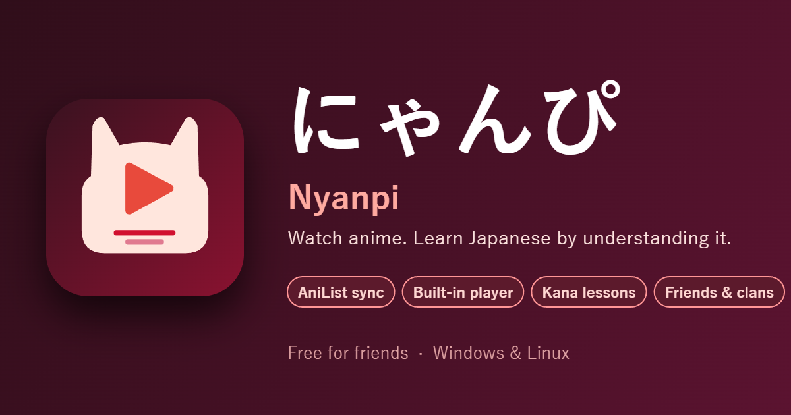

# Nyanpi (にゃんぴ)

A free, fan-made desktop app for watching anime and learning Japanese by understanding it. It syncs with your AniList, plays anime with Japanese subtitles, teaches kana and grammar, and has a small invite-only community for you and your friends.

> ## 🔑 You need an invite code
> Nyanpi is **invite-only**. The first time you open it, it asks for a **display name** and an **invite code**. Without a code the app cannot be used.
> **Ask the person who sent you this link for a code.** Each code works once.

## Download

Go to the **[latest release](https://github.com/Nyanpi-cloud/nyanpi-releases/releases/latest)** and download the file for your system:

| System | File | Updates |
|---|---|---|
| **Windows** | `Nyanpi-Setup.exe` | Updates itself |
| **Linux** | `Nyanpi-<version>.tar.gz` | Download the new file for each version |

Ignore the other files on the release page (`latest.yml`, `.blockmap`, "Source code"). They are used by the updater, and the source-code downloads do not contain the app.

### Windows
1. Run `Nyanpi-Setup.exe`.
2. Windows may say **"Windows protected your PC"** because the app is not code-signed. Click **More info**, then **Run anyway**.
3. Choose a folder (or keep the default) and finish. A shortcut is placed on your desktop.
4. Open Nyanpi and enter your name and invite code.

### Linux
1. Extract the `.tar.gz`.
2. Run the `nyanpi` program inside the folder.
3. If it does not start, run it from a terminal as `./nyanpi --no-sandbox`.

## First steps
1. **Enter your invite code** and pick a display name.
2. **Connect your AniList account** (Nyanpi uses it for your profile, list and stats).
3. Take the short tour, then add the folders where your anime lives.
4. Try the **kana lessons** if you are starting from zero, or **Watch next** in Discover to find something at your level.

## What it does
- **AniList profile and stats**, with your list, levels and achievements.
- **Built-in player** for Japanese subtitles, with word lookup and Anki integration.
- **Guided lessons** for hiragana, katakana and grammar, with memory pictures and quizzes.
- **Watch next**: suggestions sorted by Japanese difficulty, and downloads through qBittorrent.
- **Social**: leaderboard, global chat, factions with tags, levels and titles. Chat has replies, edits, notifications and mute options.
- **Your look**: choose and hide tabs, colour schemes, light mode.

## Updates
Windows copies update themselves. Nyanpi checks for a new version shortly after it starts and every few hours. When one has downloaded, Nyanpi shows a short countdown and restarts into it. Your progress is saved.

## Privacy: what others in the community can see
Your display name, level, XP, titles, what you watched in the last 30 days, characters read, and your AniList picture. Nothing else. You can leave the community from the Social tab. After leaving, Nyanpi asks for a new invite code before it can be used again.

## Troubleshooting
- **"That invite code is not valid or was already used":** codes work once. Ask for a new one.
- **"Your access ended":** your membership was removed. Ask the person who invited you.
- **Windows warns about the installer:** expected, see the Windows steps above.
- **The community is full:** the group has a member limit. Ask the owner.

## Good to know
- Learning Japanese without subtitles takes years of small daily steps. Nyanpi is a helper, not a shortcut.
- This repository only hosts the installers.
- Nyanpi is not affiliated with AniList, Jimaku or any anime studio.
